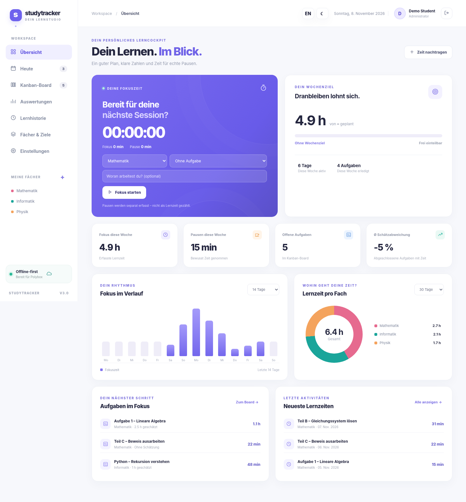

# StudyTracker 3.0

**Kostenloser, lokal laufender Lerntracker für Ubuntu/Linux** mit Kanban, eigenständigen Unteraufgaben, Zeitmessung, Pausenprotokoll und Soll-Ist-Analysen. Die Daten können in deinem privaten Polybox-/Nextcloud-Synchronisationsordner liegen. Kein Abonnement, kein Datenbankserver, keine zusätzlichen Python-Pakete.

**Sprachen:** [Deutsch](README.de.md) · [English](README.md)  
**Agent-Anleitungen:** [Deutsch](AGENTS.de.md) · [English](AGENTS.md)



## Funktionen

| Bereich | Möglichkeiten |
|---|---|
| **Kanban** | Geplant → In Arbeit → Erledigt, Drag & Drop, Fächer, Tags, Prioritäten, Fälligkeiten |
| **Unteraufgaben** | B/C/D als eigenständige, sichtbare Kanban-Karten mit Verknüpfung zur Hauptaufgabe |
| **Status-Verknüpfung** | Sind alle Unteraufgaben fertig, wird die Hauptaufgabe erledigt. Hauptaufgabe abhaken/öffnen wirkt auf alle Unteraufgaben; nur eine Unteraufgabe wieder öffnen wirkt auf die Hauptaufgabe |
| **Freie Zeitschätzungen** | Für Haupt- und Unteraufgaben optional; fehlende Schätzungen werden nicht als null Minuten behandelt |
| **Für heute** | Ganze Aufgaben oder beliebige einzelne Teile für heute markieren; die Tagesansicht zeigt die Auswahl |
| **Semester** | Semester anlegen, Fächer zuordnen, Fächer auch ohne Semester lassen |
| **Fächerfarben & Ziele** | Gut sichtbare Farbkacheln oder freier Farbwähler; Wochenziele vollständig optional |
| **Timer & Pausen** | Fokuszeit, echte Pausen mit Uhrzeiten, Unterbrechen/Fortsetzen, Session speichern |
| **Statistiken** | Lernzeit pro Fach, Wochen-/Monatsansichten, Soll-Ist-Differenz, kumulierter Verlauf |
| **Benutzer** | Administrator legt weitere lokale Benutzer an; getrennte Profile, Timer und Statistiken |
| **Daten** | JSON-Backup/Wiederherstellung, CSV-Export für Lernzeiten und Aufgaben |
| **Agentenimport** | JSON-Aufgaben aus E-Mails über Upload oder automatischen Polybox-Posteingang, Duplikate werden erkannt |
| **Oberfläche** | Deutsch/Englisch, Hell/Dunkel, Browser-Tab-Icon |

### Screenshots

[Dashboard](docs/screenshots/01-Dashboard.png) · [Kanban mit Unteraufgaben](docs/screenshots/02-Kanban.png) · [Unteraufgabe bearbeiten](docs/screenshots/03-Subtask.png) · [Heute](docs/screenshots/04-Today.png) · [Auswertungen](docs/screenshots/05-Insights.png) · [Semester](docs/screenshots/06-Semesters.png) · [Farbauswahl](docs/screenshots/07-Colors.png) · [Einstellungen](docs/screenshots/08-Settings.png) · [Englisch](docs/screenshots/09-Settings-English.png) · [Dark Mode](docs/screenshots/10-Kanban-Dark.png) · [Timer](docs/screenshots/11-Timer-Dark.png) · [Schmales Display](docs/screenshots/12-Mobile.png)
| Laufende Pause im Dark Mode | [Pause](docs/screenshots/13-Break-Dark.png) |
| Lernhistorie im Dark Mode | [Lernhistorie](docs/screenshots/14-History-Dark.png) |

> Die Screenshots wurden mit Beispieldaten und einer **simulierten Browser-API** erstellt. Die reale Python-Schnittstelle wurde gesondert getestet; ein vollständiger Browser-zu-Localhost-Test war in der Testumgebung blockiert.

## Installation unter Ubuntu

Voraussetzung: Python **3.10+** und ein moderner Browser. Es wird **kein** `pip install` benötigt.

```bash
cd ~/Nextcloud/study_tracker  # oder dein Projektordner
chmod +x start.sh
./start.sh
```

Die App erreichst du unter **http://127.0.0.1:8765**. Beim ersten Start richtest du ein Administratorkonto mit mindestens zehn Zeichen Passwort ein. Danach kannst du Fächer, Semester, Aufgaben und Unteraufgaben erstellen.

```bash
./start.sh --port 8766       # anderer Port
./start.sh --no-browser      # Browser nicht automatisch öffnen
```

**Update von StudyTracker 2.x:** Sichere zuerst den gesamten Ordner `data/`. Ersetze nur die Programmdateien, nicht deine bestehenden `data/accounts.json` und `data/profiles/`. Die neuen Felder sind rückwärtskompatibel; JSON-Backups verwenden weiterhin `version: 2`.

## Unteraufgaben sinnvoll nutzen

Beispiel: Hauptaufgabe **Aufgabe 1**, Teilaufgaben **B**, **C**, **D**.

1. Hauptaufgabe im Kanban erstellen.
2. Auf **+ Teil** auf ihrer Karte klicken oder beim Anlegen einer Aufgabe die **Hauptaufgabe** auswählen.
3. B/C/D erscheinen **direkt als eigene Kanban-Karten**, nicht versteckt in einem Dialog.
4. Du kannst beispielsweise nur B und C **für heute markieren**, einzeln mit dem Timer bearbeiten oder abhaken. Markierst du stattdessen Aufgabe 1 für heute, erscheinen auch ihre Teilaufgaben in der Tagesansicht.
5. Für jede Aufgabe ist die Zeitschätzung **optional**; auch das Erfassen von Lernzeit ist je Aufgabe separat möglich.
6. Sobald B, C und D erledigt sind, wird automatisch Aufgabe 1 abgeschlossen. Wenn du Aufgabe 1 abhaken willst, werden alle Teilaufgaben abgeschlossen. Wird die Hauptaufgabe wieder geöffnet, werden alle Teilaufgaben auf **Geplant** gesetzt; öffnest du nur C wieder, bleiben B und D erledigt.

Der Einfachheit halber gibt es **eine Unteraufgabenebene**. Haupt- und Unteraufgaben müssen zum gleichen Fach gehören. Wenn du eine Hauptaufgabe löschst, bleiben die Unteraufgaben als eigenständige Aufgaben erhalten.

### Statistiken ohne Doppelzählung

In der Gesamt-Soll-Ist-Auswertung wird jede **Hauptaufgabe/eigenständige Aufgabe nur einmal** gezählt. Die Ist-Zeit einer Hauptaufgabe umfasst ihre eigenen Sessions **und** die der Teilaufgaben. Die Schätzung der Hauptaufgabe dient als Gesamtbudget. Ist sie leer, werden die Schätzungen aller Unteraufgaben addiert, aber nur, wenn **alle** geschätzt wurden. Unbekannte Schätzungen werden aus dem Gesamtvergleich ausgeschlossen. Details der einzelnen Unteraufgaben bleiben in der Tabelle sichtbar. Im CSV stehen direkte Werte und aufsummierte Gesamtwerte getrennt.

Pausen zählen **nicht** als Lernzeit.

## Datenspeicherung und Polybox

Die App speichert ihre Daten standardmäßig unter `data/`:

```text
study_tracker/
├── server.py
├── start.sh
├── static/
├── AGENTS.md                 # Agentenanleitung Englisch
├── AGENTS.de.md              # Agentenanleitung Deutsch
└── data/                     # beim Start erstellt, von Git ignoriert
    ├── accounts.json        # Benutzer und gesalzene Passwort-Hashes
    ├── profiles/<id>.json   # Aufgaben, Semester, Sessions, Pausen pro Person
    └── inbox/<name>/        # Importordner für Agenten
        ├── processed/
        └── rejected/
```

Wenn der Ordner in einem **privaten** Polybox-/Nextcloud-Verzeichnis liegt, synchronisiert dein Client die Dateien. Polybox stellt aber **keinen Webserver** bereit. StudyTracker ist ausschließlich an `127.0.0.1` erreichbar. Verwende denselben Datenbestand **nicht gleichzeitig auf mehreren Computern**; konkurrierende Synchronisationsänderungen können Daten überschreiben. Mehrere Benutzer **innerhalb einer laufenden App** werden unterstützt.

Datenspeicher separat setzen:

```bash
STUDYTRACKER_DATA_DIR="$HOME/Nextcloud/private-study-data" ./start.sh
```

Zusätzliche tägliche Sicherungen liegen standardmäßig unter `~/.local/share/studytracker/backups/` (maximal 30 pro Benutzer). Bei Bedarf lässt sich das mit `STUDYTRACKER_BACKUP_DIR` ändern. Die Profil-JSON-Dateien sind **nicht verschlüsselt**; nur die Passwörter werden als gesalzene PBKDF2-Hashes gespeichert.

### Git-Sicherheit

Die `.gitignore` schützt insbesondere `/data/`, `/exports/`, `/backups/` und typische persönliche Exportdateien. Vor dem Push:

```bash
git check-ignore -v data/accounts.json
git ls-files data/   # keine Ausgabe erwartet
```

Bereits getrackte Dateien werden durch `.gitignore` nicht nachträglich entfernt. Niemals persönliche JSON-Backups oder CSV-Dateien committen.

## Aufgaben aus E-Mails automatisch importieren

Anleitungen: **[AGENTS.de.md](AGENTS.de.md)** ([English](AGENTS.md)), [Importanleitung](docs/IMPORT.de.md) ([English](docs/IMPORT.md)) und [Agent-Prompt](prompts/email-to-tasks.de.md) ([English](prompts/email-to-tasks.md)). Das maschinenlesbare Format steht in [`schemas/tasks-import.schema.json`](schemas/tasks-import.schema.json), ein Beispiel in [`examples/email-task-import.json`](examples/email-task-import.json).

```json
{
  "format": "studytracker.tasks.v1",
  "batch_id": "mail-analysis-2026-11-08",
  "tasks": [
    {"external_id":"mail-x:1","subject":"Mathematik","semester":"Herbstsemester 2026","title":"Übungsblatt 1","planned_minutes":120},
    {"external_id":"mail-x:1:B","parent_external_id":"mail-x:1","subject":"Mathematik","semester":"Herbstsemester 2026","title":"Teil B","planned_minutes":null},
    {"external_id":"mail-x:1:C","parent_external_id":"mail-x:1","subject":"Mathematik","semester":"Herbstsemester 2026","title":"Teil C","planned_minutes":35}
  ]
}
```

Die Verknüpfung funktioniert unabhängig von der Reihenfolge in der Datei. `batch_id` und `external_id` müssen bei wiederholten Importen gleich bleiben. **Die JSON-Schlüssel sind in beiden Sprachen identisch.**

Die fertige Datei kannst du in `data/inbox/<benutzername>/` ablegen oder über **Einstellungen → Import** hochladen. Die laufende App verarbeitet sie und verschiebt sie nach `processed/` bzw. `rejected/`. **E-Mails selbst werden nicht automatisch gelesen**; dafür brauchst du einen separat autorisierten Agenten/Connector.

## Tests

```bash
python3 -m unittest discover -s tests -v
node --check static/app.js
node --check static/i18n.js
```

**21 erfolgreiche Tests** für Kontentrennung, CSV/JSON, Pausen, sichere Importe, Status-Verknüpfung von Unteraufgaben, Löschen und Backup. Die Oberfläche wurde zusätzlich im Chromium-Browser mit simulierten Daten geprüft.

## Weitere Dokumente

- [API Deutsch](docs/API.de.md) · [API English](docs/API.md)
- [Import Deutsch](docs/IMPORT.de.md) · [Import English](docs/IMPORT.md)
- [Changelog Deutsch](CHANGELOG.de.md) · [Changelog English](CHANGELOG.md)
- [MIT-Lizenz](LICENSE)
