# StudyTracker

**A private, local-first study planner and time tracker for Ubuntu/Linux.** Plan courses and assignments, work on independently visible subtasks, measure focus and breaks, analyse *when* and *how* you study, and optionally evaluate exercises yourself or with ChatGPT.

**Free · open source · Python 3.10+ · vanilla JavaScript · no database server or subscription.** The application runs on your computer; its JSON data can live inside a private Polybox/Nextcloud sync folder.

**Docs:** [English](README.md) · [Deutsch](README.de.md) · [Agent instructions (EN)](AGENTS.md) · [Agent instructions (DE)](AGENTS.de.md) · [API](docs/API.md) · [Import format](docs/IMPORT.md) · [Exercise reviews](docs/EXERCISE_REVIEW.md) · [Performance](docs/PERFORMANCE.md)

> **Screenshots:** All screenshots below come from **demonstration profiles**, not real student accounts. Some show earlier UI iterations (including German labels) and may look slightly different from the latest review and import workflows. They illustrate real application features; the current behavior is described in the text. See the [screenshot gallery](#screenshot-gallery--20-views) for all 20 illustrated views.

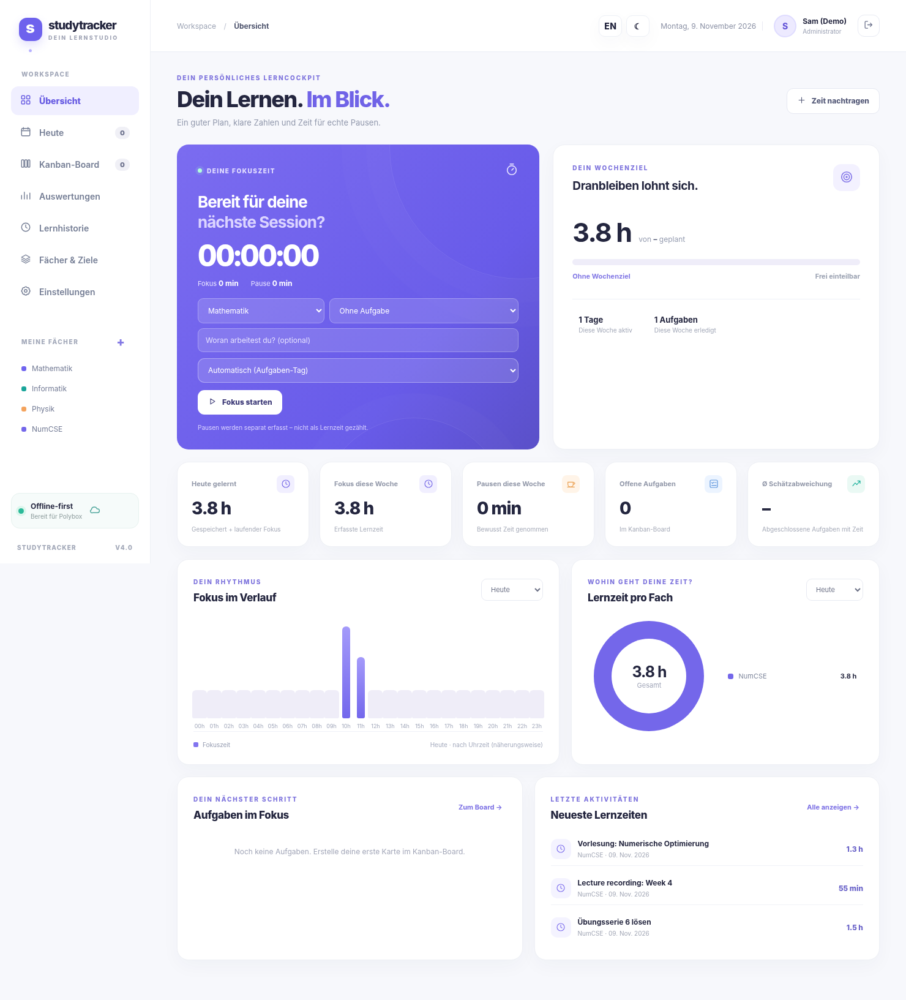

*The Overview combines today's study time, work in progress, recent sessions, study rhythm and subject breakdowns.*

## Contents

- [Install and start](#install-and-start)
- [Feature overview](#feature-overview)
- [Overview and Today](#overview-and-today)
- [Kanban, tasks and independent subtasks](#kanban-tasks-and-independent-subtasks)
- [Time tracking, categories and breaks](#time-tracking-categories-and-breaks)
- [Analytics and reports](#analytics-and-reports)
- [Exercise assessments: yours and ChatGPT's](#exercise-assessments-yours-and-chatgpts)
- [AI-assisted task import](#ai-assisted-task-import)
- [Subjects, semesters and settings](#subjects-semesters-and-settings)
- [Users, data, privacy and backups](#users-data-privacy-and-backups)
- [Screenshot gallery — 20 views](#screenshot-gallery--20-views)
- [Testing and troubleshooting](#testing-and-troubleshooting)
- [Limitations and design choices](#limitations-and-design-choices)

## Install and start

**Requirements:** Ubuntu or another Linux distribution, **Python 3.10 or later**, a modern browser and a private directory you can write to. No `pip install` is necessary.

```bash
# Example: run from your existing checkout
cd ~/Nextcloud/study_tracker
chmod +x start.sh
./start.sh
```

The application normally opens **http://127.0.0.1:8765**. On the first run, create the local administrator account (password: at least 10 characters). From Settings, the administrator can create additional users.

```bash
./start.sh --port 8766        # use a different local port
./start.sh --no-browser       # do not open a browser automatically
```

To keep **code and personal data separate**:

```bash
STUDYTRACKER_DATA_DIR="$HOME/Nextcloud/private-study-data" ./start.sh
```

**Updating an existing installation:** Back up `data/` first; pull new source code without deleting or overwriting `data/accounts.json` or `data/profiles/`. After updating, restart the server and hard-refresh the browser (`Ctrl+Shift+R`). Do **not** run multiple instances against the same synchronised profile concurrently.

## Feature overview

| Area | Capabilities |
|---|---|
| **Overview** | Today's focus time (including a running session), recent sessions, daily rhythm, subject allocation and progress indicators |
| **Today** | Choose whole assignments or individual subtasks; chosen work remains selected after midnight until unmarked |
| **Kanban** | To do / In progress / Done; drag-and-drop, priority, deadline, notes, tags, estimates, timer shortcuts and an Import tasks shortcut |
| **Subtasks** | Independently visible Kanban cards linked to one parent; optional independent estimates and sessions, synchronized completion rules |
| **Archive** | Completed cards automatically leave the active board after 48 hours; search and filter by subject and completion period; reopen without losing history |
| **Focus timer** | Start, pause, resume, true break, finish or discard; link to a subject/task and a primary study category |
| **History** | View, add, edit and delete individual study sessions; inspect saved break times |
| **Study analytics** | Hourly/daily/monthly patterns; subject/category totals; estimates versus actuals; 24/48-hour and weekly time-of-day heatmaps |
| **Exercise ratings** | Independent optional **My** and **ChatGPT** feedback; difficulty, correctness, assistance, multiple issues, short observations and next actions |
| **Import assistant** | Choose a valid subject ID and optional parent task; seven bilingual, source-specific Markdown instruction sets; copy/download instructions and import JSON |
| **Courses** | Subjects, optional weekly targets, colours, semesters, tags and custom categories |
| **Accounts & portability** | Multiple local accounts, per-user JSON, CSV exports, JSON backup/restore, local daily backups, Polybox/Nextcloud-compatible folders |
| **Interface** | German/English toggle, dark/light mode, responsive layouts and accessible chart tooltips |

## Overview and Today

The **Overview** is the home screen for quick decisions: how much focus time you have recorded today, the current timer, recent study sessions and charts. The weekly goal and the subject breakdown now default to the **same current-week period**; both count **focus time only**, while breaks are reported separately. The **Today** page is a shortlist of your selected work, not a second Kanban board.

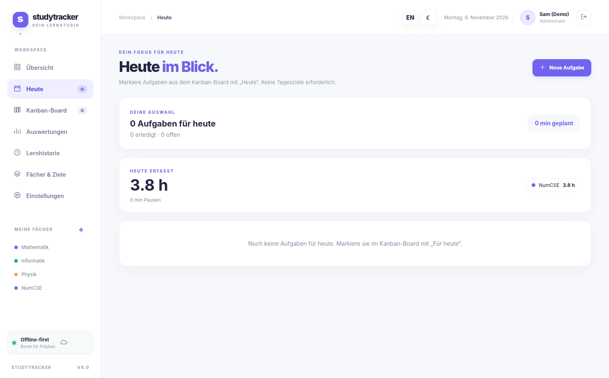

*The Today page shows the work you deliberately selected and how much you have studied in the current day, including a breakdown by subject.*

**Selecting tasks for Today**

1. Find a task or independent subtask on Kanban and mark it **For today**.
2. Select *just B and C* from an assignment, or select the parent to include the group.
3. Start the timer from that card or from Today.
4. When midnight passes, the selection **stays** until you explicitly remove it. This is useful when working late; completion status and date-specific study-time totals are separate concepts.

A task's **due date** is not the same as its **Today selection**. The amount *studied today* still resets at the local midnight, while **unfinished pinned tasks remain visible across midnight** until you explicitly remove the selection. **Completed tasks move into a muted, collapsed “Recently completed” section for the first 24 hours after completion**, then disappear from Today. They remain saved in Kanban/history; reopening an older pinned task makes it active in Today again. No saved tasks or pins are deleted by this filter.

## Kanban, tasks and independent subtasks

Kanban has three statuses: **To do**, **In progress** and **Done**. Drag tasks between columns or use their controls. Each task can include a title, description, subject, priority (`low`, `normal`, `high`), optional due date, arbitrary tags and an optional estimate in minutes.

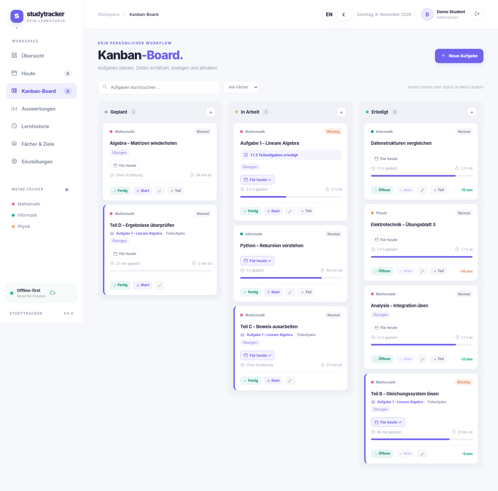

*Parent assignments and their child exercises are separate, actionable cards; neither needs to be expanded to see the children.*

### Independent subtasks

Consider **Assignment 1** with parts A, B, C and D. Create the parent, then select **+ Subtask** (or choose the parent inside the task editor). Each part becomes an ordinary, visible Kanban card with its own status, timer, estimate and Today selection.

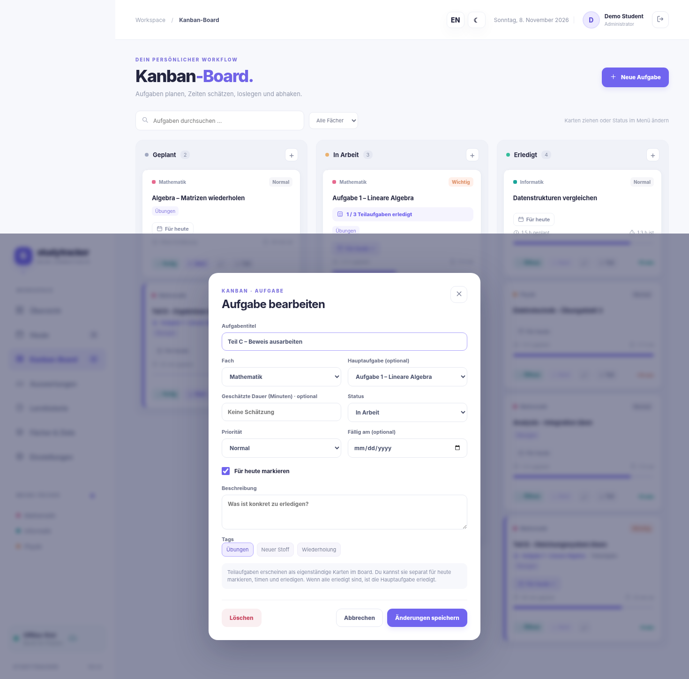

*The subtask editor links a task to an existing parent; subtasks can be worked on individually.*

Completion rules deliberately work in both directions:

- Completing **all children** completes the parent automatically.
- Explicitly completing a **parent** completes all children.
- Reopening a **parent** resets its children to To do.
- Reopening **one child** reopens the parent but keeps other finished children done.
- Deleting a parent **detaches** its children instead of deleting the work history.

Only **one level** of child tasks is supported. A child must belong to the same subject as its parent.

### Estimated versus actual duration

Estimates are optional. Record actual time against a specific task (or its children). In aggregated calculations, parent time is rolled up from its own sessions and its children's sessions **without counting the same time twice**. If the parent has no estimate, child estimates are used as a combined estimate only when **every child has one**; unknown estimates are not interpreted as zero.

### Archive of completed work

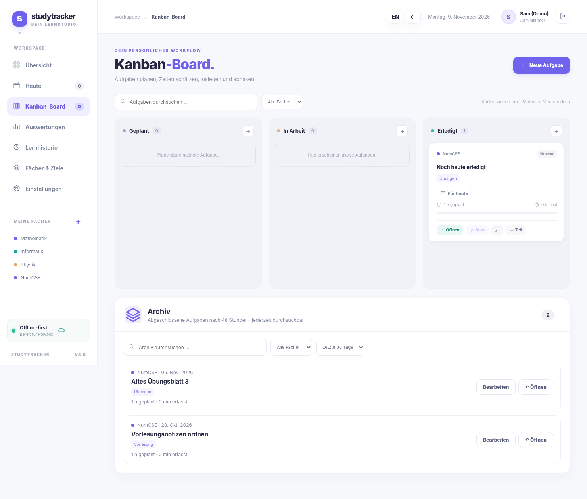

*Cards completed at least 48 hours ago are displayed in a collapsible archive instead of crowding the active board.*

Filter archived work by **last 10 days**, **last 30 days** or **all time**, narrow by subject, and search by text. Click **Reopen** to return a card to Kanban. Archiving is a *view*, not deletion: task data, ratings, parent links and session history remain in JSON.

## Time tracking, categories and breaks

Start a focus session from a task or the timer panel, select its subject and optionally its primary activity category. The timer supports **pause**, **resume**, **break**, **end break**, **stop/save** and **discard**. Focus time and break time are separate.

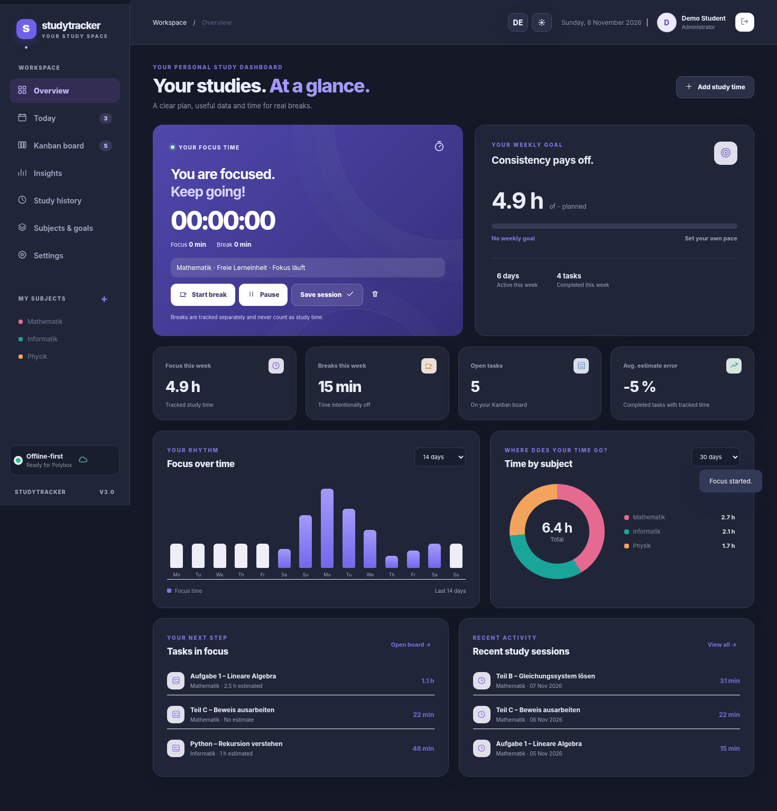

*The focus timer links elapsed time to your learning activity and, when selected, the associated task.*

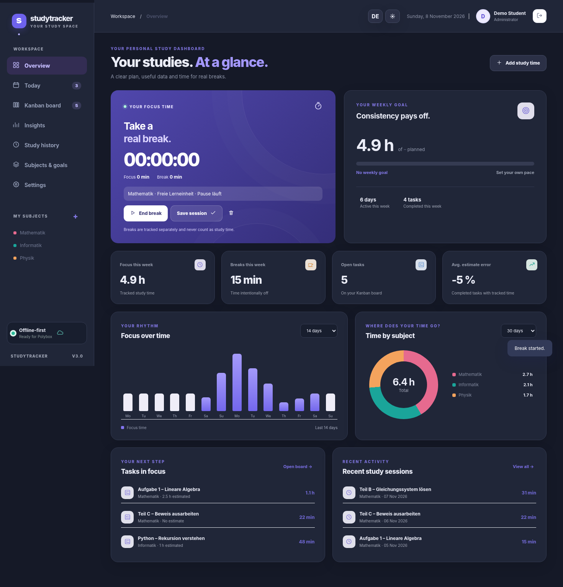

*Breaks have their own duration and do not inflate your study totals.*

A session may be recorded with the built-in timer or entered **manually** afterwards. You can edit/delete historical entries and inspect saved break periods in the **History** view.

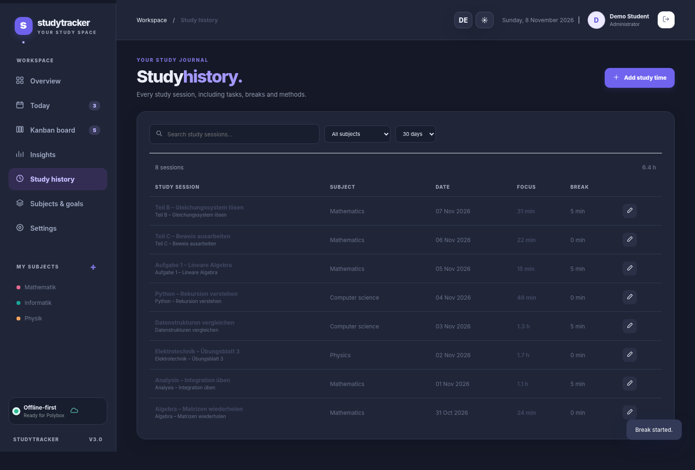

*The history lists recorded work, dates, subjects, focus durations and break details.*

**Categories versus tags:** A task can have multiple organizational tags, while each session has **one optional primary category**. Common defaults include **Vorlesung** (lecture), **Videos** and **Übungen** (exercises). Select the primary category when starting a timer or editing a manual session. Category analysis counts each session **once**, not once per tag. Entries without a category are shown separately; older tagged sessions have a documented fallback.

## Analytics and reports

StudyTracker deliberately measures **time and task progress** separately from self-reported exercise performance. Use the **Insights / Auswertungen** section and its period and subject selectors.

### Overview, rhythm and subjects


*The Overview can focus on **Today** for the rhythm and subject-distribution charts. The current focus timer contributes to today's total.*

### Category breakdown

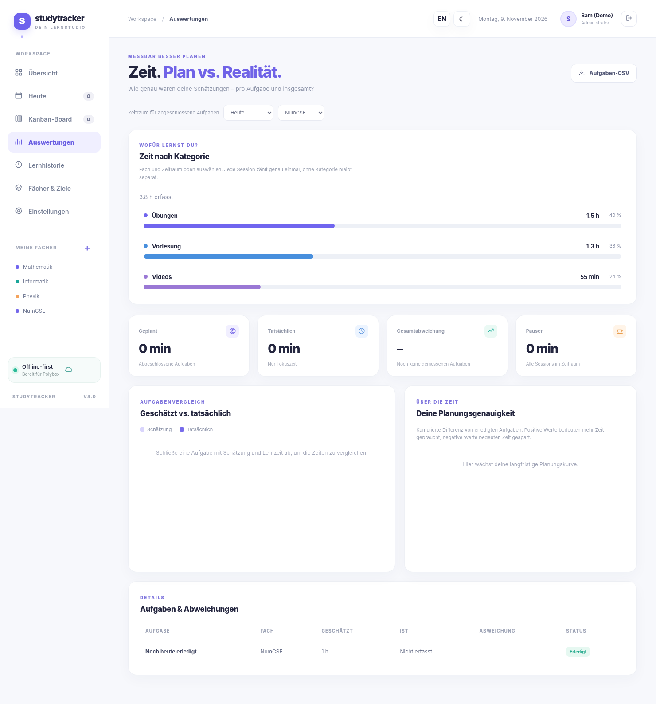

*Filter a course, for example NumCSE, to see how time is distributed between exercises, lectures, videos and your other chosen categories.*

### Planned versus actual time

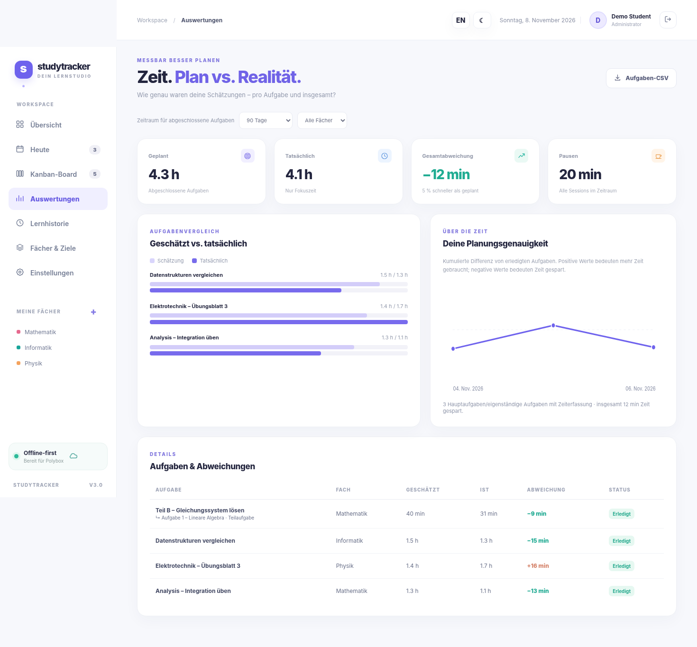

*Compare time estimates with recorded focus time, see differences for individual tasks and inspect aggregate estimation performance. Missing estimates do not skew the aggregate.*

### Time-of-day heatmaps


*The typical-week heatmap shows which weekdays and clock hours tend to contain study sessions; the course filter applies to the chart.*

Choose among four time-window modes:

- **Last 24 hours** and **last 48 hours:** rolling windows; partial boundary hours are handled.
- **Typical week:** the mean per weekday and hour across **calendar weeks with recorded focus** (not every week since installation).
- **Cumulative weekly pattern:** the total across all recorded weeks; e.g., repeated Friday 08:00–10:00 lectures accumulate in Friday morning cells, and late study between 01:00 and 02:00 accumulates in that hour.

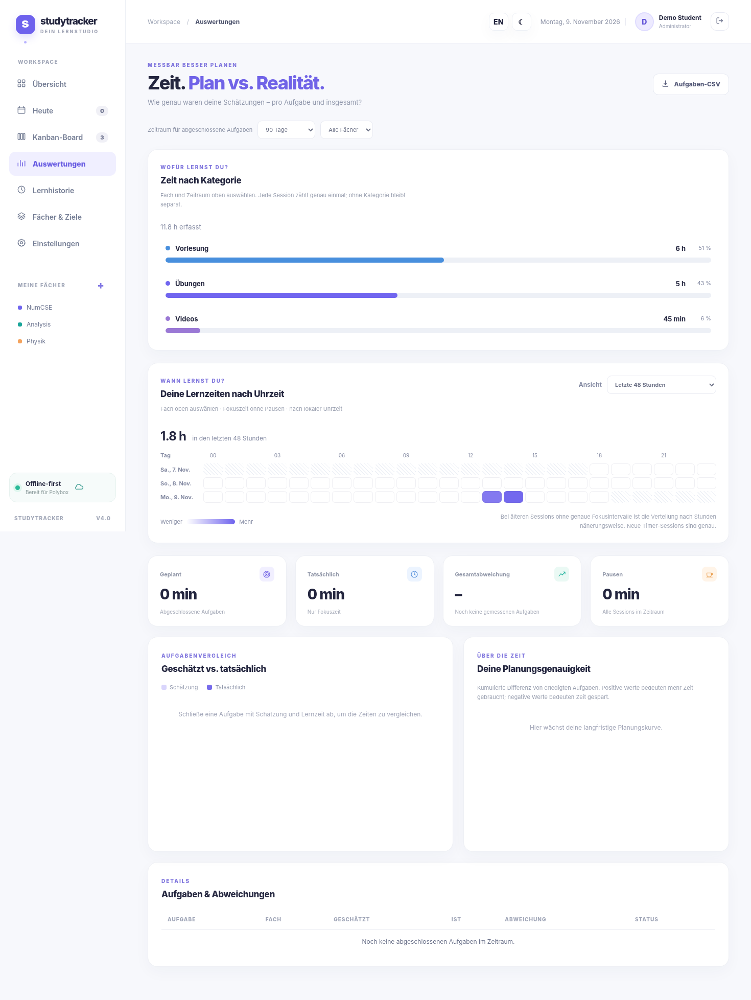

*Illustration of the rolling 48-hour mode (older German-labeled screenshot; the same view is available in English).* 

New timer sessions store individual `focus_intervals` with exact start/end timestamps. This means pauses, breaks and midnight boundaries are allocated correctly. **Older sessions** without those intervals can only be placed approximately on the hourly chart, and the UI indicates that limitation. All calculations use the browser's local time zone.

### Tooltips

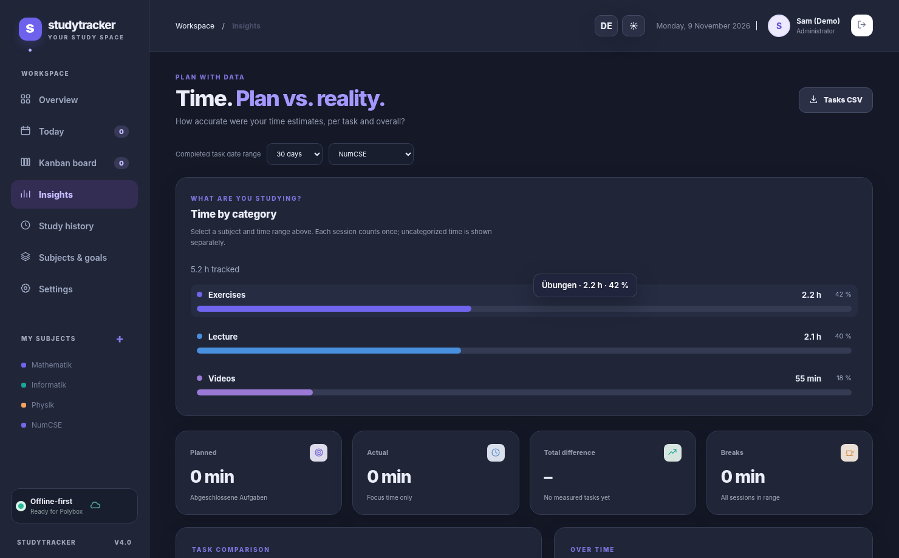

*Hover or keyboard-focus a chart element to inspect durations and, where relevant, percentages.*

### Recurring issues and next steps

The richer-feedback branch also provides a lightweight **feedback insights** area. It can aggregate recurring issue codes, frequently reported skill gaps and suggested next actions, using the current subject/date filters and a **Self / GPT** source selector. These summaries come from your recorded, optional exercise ratings—not from an automatic diagnosis of learning ability.

## Exercise assessments: yours and ChatGPT's

Each task can hold **one current self assessment** and **one separate ChatGPT-suggested assessment**. This is **not** an attempt history; an exam/practice-test mode is not included. Both sources are optional, and every individual field can remain empty.

### What is recorded?

| Field | Values | Purpose |
|---|---|---|
| `difficulty` | `1`–`5` or empty | Your impression of difficulty (or GPT's supported suggestion) |
| `outcome` | `correct`, `partial`, `incorrect`, or empty | Whether you solved it correctly |
| `issue` | One optional primary issue | Backward-compatible main problem code |
| `issues` | Up to **3** distinct issue codes | Record more than one difficulty in the same exercise |
| `help_total` | `0`–`5` or empty | Amount of assistance from all sources |
| `help_chatgpt` | `0`–`5` or empty | Amount of assistance attributable to ChatGPT |
| `strength`, `weakness` | One sentence each, max **200 characters** | Concise, specific positive and negative observations **from each source** |
| `skill_gap` | Max **100 characters** | Specific skill to practise |
| `next_action` | Max **160 characters** | One concrete suggested next step |
| `chatgpt_interventions` | Up to **3** types | How ChatGPT helped, not merely how much |

The eight issue codes are `concept`, `approach`, `calculation`, `implementation`, `instructions`, `careless`, `time`, and `verification`. The eleven intervention types are `verification`, `hint`, `guiding_questions`, `concept_explanation`, `approach_selection`, `step_by_step`, `debugging`, `calculation`, `code_generation`, `full_solution`, and `error_identification`.

**`0` is not the same as empty:** a help rating of `0` means *no help*; an unanswered field means *not assessed*. If both help scores are set, ChatGPT's help score must not exceed total help.

### Review workflow

1. On Kanban, Today or the archive, click **Rate / Bewerten**.
2. Optionally fill in **My assessment**: difficulty, correctness, one or more issues and concise observations. You can leave the entire form empty.
3. Click **Copy prompt** for ChatGPT. The instructions require one **copyable fenced `json` code block**, not an unformatted paragraph, and say to report only evidence supported by the task, your solution and the chat.
4. Paste ChatGPT's response into the separate GPT section; check its suggestions. Your original ratings are **not overwritten automatically**.
5. If useful, select **Use GPT** for individual fields; save to preserve **both sources** in the task record.
6. Reopen the assessment later to review or edit it. JSON backups and the task CSV include the saved sources.

For example, ChatGPT can suggest:

```json
{
  "difficulty": 3,
  "outcome": "partial",
  "issue": "concept",
  "issues": ["concept", "approach"],
  "help_total": 4,
  "help_chatgpt": 4,
  "chatgpt_interventions": ["hint", "concept_explanation"],
  "strength": "Set up the constraints independently.",
  "weakness": "Needed guidance when choosing the pivot.",
  "skill_gap": "Simplex pivot selection",
  "next_action": "Solve one similar pivot-selection task without hints."
}
```

This is **example data**, not a real judgment about an exercise. The prompt should use `null` for unsupported observations rather than inventing your abilities or mistakes. Feedback is only as trustworthy as the provided task, solution and conversation. StudyTracker **does not contact ChatGPT automatically** or save entire chat transcripts.

See [the exercise-rating specification](docs/EXERCISE_REVIEW.md) and [the English assessment prompt](prompts/exercise-review.md) ([German](prompts/exercise-review.de.md)).

## AI-assisted task import

The AI import workflow is a **local instruction generator + validated JSON importer**, not an email client or autonomous cloud agent. There is a shortcut **Import tasks** beside **New task** in Kanban, and the same import assistant is available in **Settings → Import**.

### Generate the right instructions

1. Select an **existing subject/module** from your account; StudyTracker inserts its exact `subject_id`.
2. Optionally select an **existing root task** if the new items should be its subtasks. The prompt then uses that task's actual `parent_id`.
3. Pick an instruction type: **email**, **ChatGPT task breakdown**, **exercise sheet/PDF**, **lecture notes/slides**, **course-platform announcement**, **syllabus/semester plan**, or **personal notes/brainstorming**.
4. Copy the tailored, **English or German Markdown instructions**, or save them as `.md`.
5. Give the instructions and relevant source content to ChatGPT/an authorized agent. Copy the returned fenced JSON block **without the Markdown fence** into a `.json` file.
6. Upload that file in the import dialog or place it in the private `data/inbox/<username>/` folder.

Seven reusable source-specific documents are also in [prompts/import/](prompts/import/), with German versions. The import assistant supplies IDs from the current signed-in user's profile; agents must not invent IDs.

### Parent and subtask import rules

- **New parent + new children:** create *separate task objects*, each child using `parent_external_id` pointing to the new parent's stable `external_id`.
- **Add children under an existing parent:** assign the selected existing **internal** `parent_id` to each new child.
- **Standalone tasks:** omit both parent keys.
- Never set **both** `parent_id` and `parent_external_id`. All children belong to the parent's subject; nesting is one level deep.
- Prefer a verified `subject_id` (and optionally the matching subject name/semester). Invalid or mismatched IDs are rejected **atomically**.
- `external_id` (per task) and `batch_id` (per import) must be stable between retries; successful repeat imports do **not** duplicate tasks.
- Do not invent deadlines, estimates, completion status, work sessions or private details.

An illustrative import with a known subject ID (replace the placeholder with an ID generated by *your own* import assistant):

```json
{
  "format": "studytracker.tasks.v1",
  "batch_id": "example-sheet-4",
  "tasks": [
    {"external_id":"sheet4","subject_id":"YOUR_EXISTING_SUBJECT_ID","title":"Exercise sheet 4"},
    {"external_id":"sheet4:B","subject_id":"YOUR_EXISTING_SUBJECT_ID","parent_external_id":"sheet4","title":"Solve part B","planned_minutes":null},
    {"external_id":"sheet4:C","subject_id":"YOUR_EXISTING_SUBJECT_ID","parent_external_id":"sheet4","title":"Solve part C","planned_minutes":40}
  ]
}
```

The old subject-name-based format still works. Imports are limited to **1–150 tasks per JSON file** (up to **1 MiB**). Valid batches go into `processed/`; rejected files move to `rejected/` with an explanation. For details, see the [import guide](docs/IMPORT.md), [JSON schema](schemas/tasks-import.schema.json), [example](examples/targeted-task-import.json) and [AGENTS.md](AGENTS.md).

**Security boundary:** StudyTracker does not read your mailbox, access ChatGPT, or execute commands from agent JSON. A separate authorized program is required to read emails and place files into Polybox. Treat email and task descriptions as **untrusted data**, not instructions to run.

## Subjects, semesters and settings

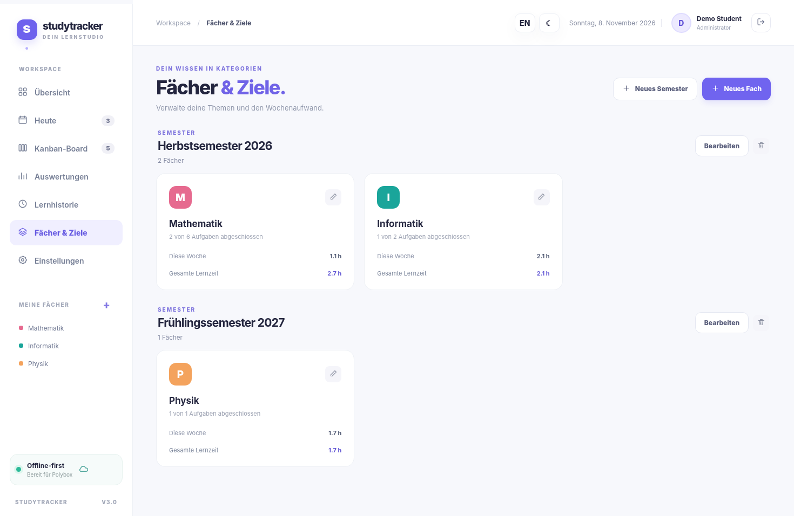

*Subjects can belong to a semester or remain unassigned; historic learning time stays with its subject.*

Subjects have a name, colour, optional semester and optional weekly goal. Both subject-level and global weekly targets can be **empty**; there is no mandatory minimum or maximum number of study hours. Tags are reusable labels; create your own categories beyond lectures/videos/exercises.

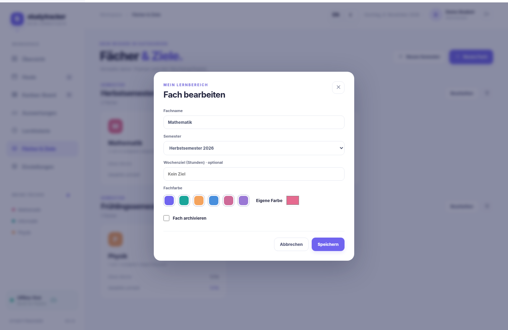

*Choose visible preset colours or a custom colour. This screen comes from an earlier UI iteration.*

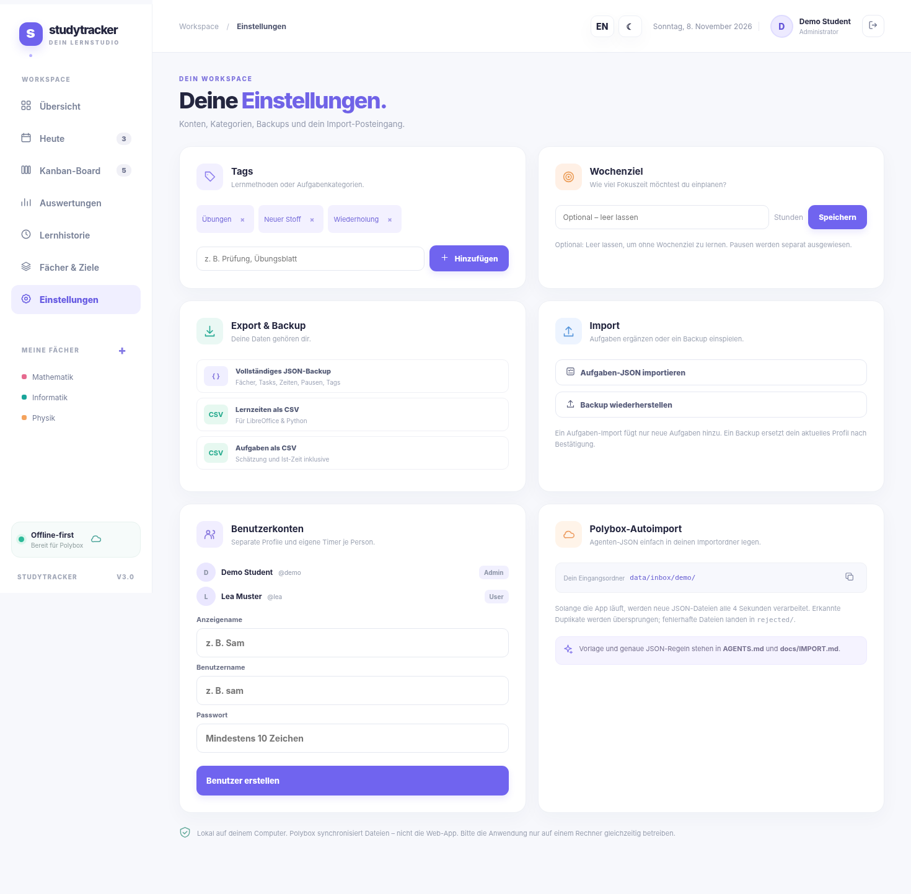

*Settings includes goals, tags, user accounts, imports and data export. The latest branch adds the more detailed import assistant.*

## Users, data, privacy and backups

The first account is an **administrator** and can add local users. Each account has its own tasks, subjects, tags, semesters, timer, sessions, breaks, reviews and settings. Passwords are stored as **salted PBKDF2 hashes**, not plaintext. The app binds to **127.0.0.1** and uses authenticated cookies. **Profile JSON is not encrypted**, so protect the device and private sync directory.

Default storage layout:

```text
study_tracker/
├── server.py
├── start.sh
├── static/                  # HTML, CSS and JavaScript
├── AGENTS.md                # English agent contract
├── AGENTS.de.md             # German agent contract
└── data/                    # private: excluded by .gitignore
    ├── accounts.json        # accounts and password hashes
    ├── profiles/<user-id>.json
    └── inbox/<username>/
        ├── processed/
        └── rejected/
```

- **JSON backup:** export and explicitly restore a full user's profile (includes reviews and focus intervals). Restoring replaces that user's profile; back it up first.
- **CSV:** export tasks (including parent links, direct/rolled-up durations and ratings) and sessions (including category, focus and break time). UTF-8 BOM + semicolon delimiters work well with LibreOffice.
- **Daily local backups:** up to 30 per profile under `~/.local/share/studytracker/backups/` by default. Set `STUDYTRACKER_BACKUP_DIR` to change this.
- **Polybox/Nextcloud:** synchronizes **files**, not the running server. Do not let two computers write the *same* synced profile simultaneously. Multiple users on one server instance are supported.
- **Git safety:** `.gitignore` excludes `data/` and common backup/export paths. It cannot retroactively remove data already committed to Git.

```bash
git check-ignore -v data/accounts.json
git ls-files data/                  # should print nothing
```

### Performance and large histories

StudyTracker uses a **single JSON profile per user**. To keep overhead down, idle polling checks a small profile-revision token rather than repeatedly downloading the whole profile. Task and session lookups are indexed in the browser; the closed archive is rendered lazily. Full profile updates still serialize the whole JSON file, so avoid concurrent writers. See the [performance audit](docs/PERFORMANCE.md), including synthetic 1,000-task and 5,000-task profiles.

For your own local size audit (no task content printed):

```bash
python3 scripts/memory_audit.py
```

## Screenshot gallery — 20 views

The sections above embed the most useful screenshots next to their explanations. Here are additional interface examples showing the available language, theme and responsive options. The images are stored **in this repository** under [`docs/screenshots/`](docs/screenshots/) and require no outside image host.

### Dark theme and English labels

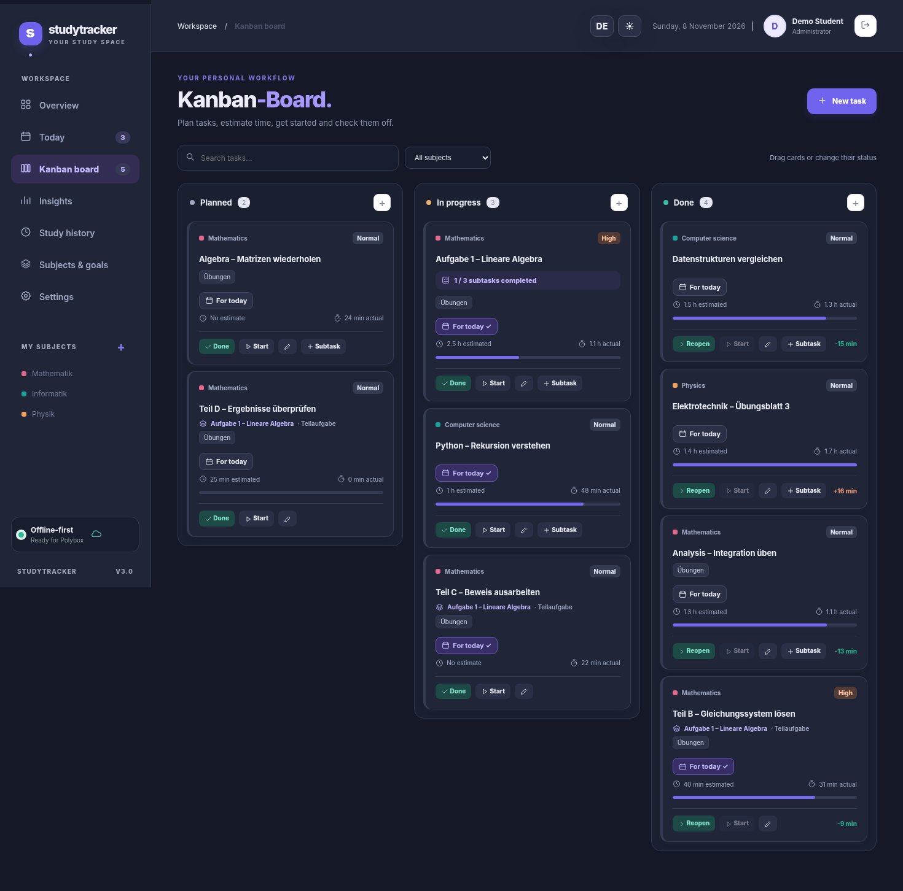

*English Kanban layout in dark mode; theme and language are independent preferences.*

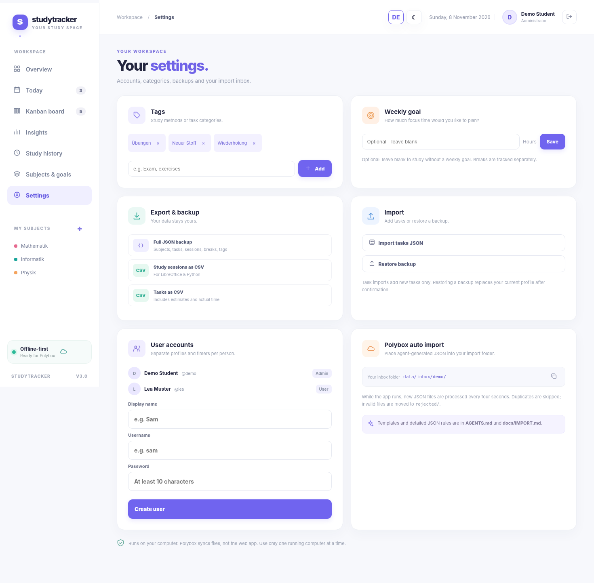

*The settings interface is also available in English. Machine-readable JSON keys remain English regardless of UI language.*

### Smaller screens

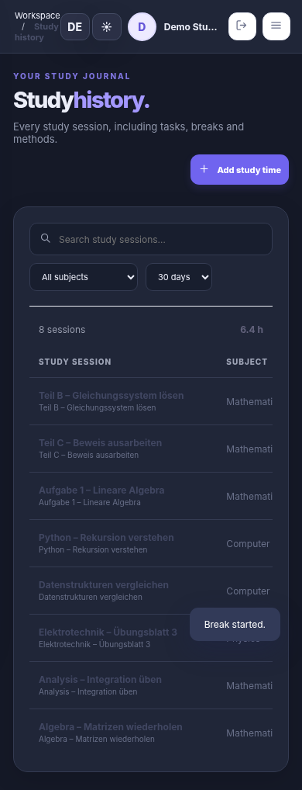

*The responsive interface adapts to smaller widths, though the current product is still designed primarily for computer use.*

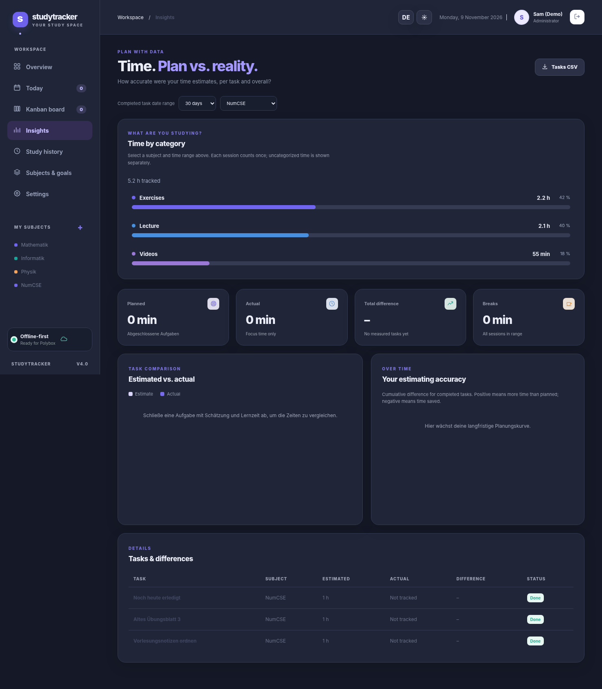

*Dark-mode analytics show the same study categories and subject/date filters.*

> **Gallery note:** Some earlier screenshots use old labels or omit recently added controls, particularly the **separate Self/GPT review**, **multi-issue feedback**, **Kanban Import tasks shortcut**, and **ID-aware import assistant**. Those workflows are accurately described above and in the linked specifications. Do not treat demonstration screenshots as current personal data or as proof of a full live-browser integration test.

## Testing and troubleshooting

Run the available repository suites:

```bash
python3 -m unittest discover -s tests -v
python3 -m py_compile server.py scripts/add_tasks.py
node --check static/app.js
node --check static/rich_feedback.js
node --check static/feedback_insights.js
node --check static/import_wizard.js
TZ=Europe/Zurich node --test tests/*.cjs
```

GitHub Actions runs Python and JavaScript tests on pushes and pull requests; see [the workflow](.github/workflows/tests.yml). UI screenshot demonstrations may use a mocked browser API; server endpoints are tested separately. Check the latest CI status on the PR before merging.

**Common issues:**

- **Missing new controls after `git pull`:** confirm your branch includes the relevant merged PR, restart `./start.sh`, then press `Ctrl+Shift+R`.
- **App does not start:** confirm Python 3.10+ and that port 8765 is not occupied; try `./start.sh --port 8766`.
- **Task import rejected:** inspect `data/inbox/<username>/rejected/` or the import error, confirm actual `subject_id` / `parent_id` and valid JSON **without** Markdown code fences.
- **GPT feedback seems missing:** paste actual JSON (not the grey placeholder); save the review and reopen it. Your rating and GPT rating are stored independently. An AI response is only a suggestion.
- **Today's task disappeared:** on older versions a date rollover could remove Today selection; the newer branch keeps a selected task pinned until unmarked.
- **Conflicting Polybox files:** stop concurrent instances, keep both copies safe and restore from a verified backup if necessary.

## Limitations and design choices

- No built-in email reader, autonomous ChatGPT integration or continuous background agent.
- No exam-preparation mode, spaced-repetition engine or per-attempt exercise history at present.
- One current **self** and one current **GPT** assessment per task; all fields are optional.
- No multi-computer concurrent editing; Polybox synchronizes files, not transactions.
- No full-text conversation archival inside task reviews (structured feedback only).
- Mobile-width support is responsive UI, not a separately installed mobile application.

This project prioritizes **a focused study workflow, understandable statistics, local data ownership and low ongoing cost** over becoming a general-purpose productivity suite.

---

**Contributions and licensing:** [MIT License](LICENSE). For implementation details, see [API](docs/API.md), [import guide](docs/IMPORT.md), [agent contracts](AGENTS.md) and the [changelog](CHANGELOG.md).