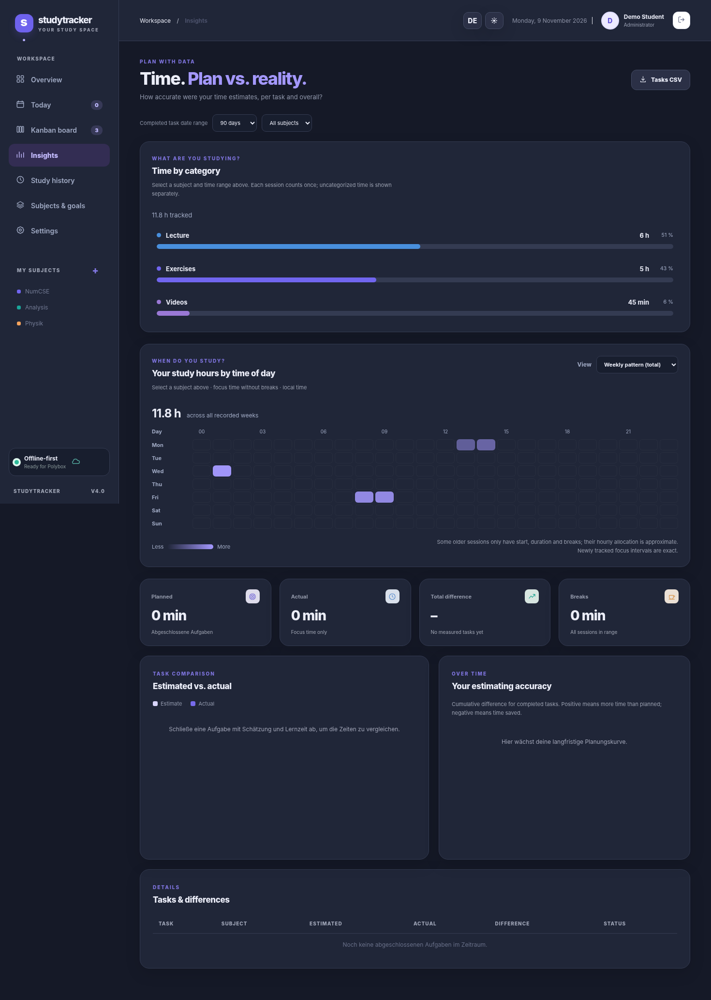

# StudyTracker 4.2

**A local, free study tracker for Ubuntu/Linux with Kanban, independent subtasks, time tracking, break logging and accurate plan-vs-actual analysis.** Works with a private Polybox/Nextcloud synchronization folder. No subscription, database server or third-party Python packages.

**Languages:** [English](README.md) · [Deutsch](README.de.md)  
**Agent instructions:** [English](AGENTS.md) · [Deutsch](AGENTS.de.md)


## Features

| Area | What you can do |
|---|---|
| **Tasks / Kanban** | To do → In progress → Done, drag-and-drop, editing, subjects, tags, priority, due dates |
| **Independent subtasks** | Create B/C/D as separate visible cards linked to parent A; start a timer, complete or select each separately |
| **Completion rules** | Completing every subtask automatically completes its parent; completing/reopening the parent also completes/reopens its children; reopening just one child reopens the parent |
| **Optional estimates** | Estimates are optional on both parent tasks and subtasks; analysis skips tasks with unknown estimates |
| **Today’s total** | See your logged focus time plus a running focus timer on the dashboard and Today page; time per subject is shown on Today |
| **Daily charts** | In Overview, select *Today* for the hourly study rhythm and the subject breakdown |
| **Kanban archive** | Done tasks remain on the board for 48 hours, then automatically appear in a collapsible archive; filter by last 10/30 days, all history, subject or text; reopen anytime |
| **Study categories** | Use session-level categories backed by tags: **Lecture**, **Videos**, **Exercises**, or any custom tag. Each session is counted **once**. Insights supports subject + period filters, including Today |
| **Tooltips** | Polished hover/focus details for study bars, subject legends, task comparisons and category graphs |
| **Today** | Mark any parent or subtask “For today”; selecting a parent shows its children in the Today view |
| **Semesters** | Create semesters and group subjects into them; existing subjects can remain unassigned |
| **Subjects and colors** | Select preset colors or any custom color; weekly targets are optional and can stay empty |
| **Timer and breaks** | Focus, true break with duration, pause/resume and saved sessions (breaks are excluded from study minutes) |
| **Statistics** | Weekly/monthly study charts, subject distribution, planned vs. actual time, cumulative estimation variance |
| **Users** | Admin creates additional local accounts; each user has their own tasks, timer, subjects, stats and JSON profile |
| **Export/import** | Full per-user JSON backup and restore; semicolon-separated CSV exports for tasks and sessions |
| **Agent task imports** | Import `studytracker.tasks.v1` JSON from uploads or a watched Polybox inbox; stable IDs avoid duplicates |
| **UI** | Light/dark theme and German/English language switch; browser-tab icon |

### What changed in v4


*New views:* [Overview / Today](docs/screenshots/v4/01-Overview-Today.png) · [Today’s work](docs/screenshots/v4/02-Today.png) · [Filtered archive](docs/screenshots/v4/03-Kanban-Archive.png) · [Category analytics](docs/screenshots/v4/04-Insights-Categories.png) · [English dark mode](docs/screenshots/v4/05-Insights-Dark-English.png) · [Narrow dark view](docs/screenshots/v4/06-Mobile-Dark.png) · [Chart tooltip](docs/screenshots/v4/07-Tooltip-Dark.png).

**Category rule:** Select a *Category* in the timer or when manually adding/editing a session. The category is stored as `category_tag_id`, referring to an existing tag; ordinary task/session tags remain supported. If an older session has no category, its first tag is used as a legacy fallback. Uncategorized sessions are shown separately. Each session contributes to exactly one category, **not** once per tag. New and upgraded profiles receive *Vorlesung* and *Videos* tags (plus the existing *Übungen*); tags remain editable. Choosing a category from the timer overrides the default task tag.

**Today and midnight:** Daily totals and hourly bars now split sessions at local midnight and include any active focus time, even if the timer began yesterday. Pauses and breaks are excluded; older sessions without saved focus intervals are distributed approximately across their recorded wall time.

**Archive rule:** Archive status is **calculated** from `status=done` plus `completed_at` older than 48 hours; no task is deleted or relocated in JSON. Both parents and independent subtasks retain their links and history. Opening a task moves it back to the board. Search and period filters operate on its completion date.


### Study-time heatmap



In **Insights → Your study hours by time of day**, use the view selector to see the **last 24 hours**, **last 48 hours**, **typical week (average per active week)**, or **weekly pattern (total across all saved weeks)**. Use the regular subject selector above to filter, e.g. NumCSE. Friday 08:00–10:00 appears in the corresponding Friday cells; repeated 01:00–02:00 sessions accumulate in that clock-hour cell. Hover over or keyboard-focus a square for the exact duration. The weekly average divides by the number of distinct calendar weeks with recorded focus time (not all calendar weeks since installation). Recent charts use a rolling 24/48-hour cutoff and show partial first/last hours. All charts use the browser’s local timezone. Pauses and breaks do **not** count.

Saved timers now persist `focus_intervals` (ISO-8601 start/end pairs, UTC) for accurate timing through pauses, breaks, midnight and resumed sessions; older profiles still work. For old sessions without these intervals, the chart estimates time placement using the start/end/duration and any recorded breaks and explicitly warns about the approximation. All exact intervals are preserved in JSON backups; CSV continues to export the overall focus minutes.

### Screenshots

| View | Screenshot |
|---|---|
| Dashboard | [Dashboard](docs/screenshots/01-Dashboard.png) |
| Kanban with separate subtasks | [Kanban](docs/screenshots/02-Kanban.png) |
| Edit a subtask | [Subtask editor](docs/screenshots/03-Subtask.png) |
| Today's tasks | [Today](docs/screenshots/04-Today.png) |
| Analytics | [Insights](docs/screenshots/05-Insights.png) |
| Semesters | [Semesters](docs/screenshots/06-Semesters.png) |
| Subject color picker | [Color picker](docs/screenshots/07-Colors.png) |
| Settings | [Settings](docs/screenshots/08-Settings.png) |
| English UI | [English settings](docs/screenshots/09-Settings-English.png) |
| Dark theme | [Dark Kanban](docs/screenshots/10-Kanban-Dark.png) |
| Timer in dark mode | [Timer](docs/screenshots/11-Timer-Dark.png) |
| Narrow screen | [Mobile width](docs/screenshots/12-Mobile.png) |
| Tracked breaks in dark mode | [Live break](docs/screenshots/13-Break-Dark.png) |
| Study history in dark mode | [History](docs/screenshots/14-History-Dark.png) |

> Screenshots use demonstration data and a **mocked browser API**. Python API and storage behavior are tested separately. A complete browser-to-localhost integration run was restricted by the test environment.

## Install on Ubuntu

You need Python **3.10+** and a modern browser. No `pip install` is needed.

```bash
cd ~/Nextcloud/study_tracker   # or wherever you extracted the repository
chmod +x start.sh
./start.sh
```

Open **http://127.0.0.1:8765** if the browser does not open automatically. On first launch, set up an administrator account (password: at least 10 characters). Then create or edit subjects, semesters, and tasks.

Optional:

```bash
./start.sh --port 8766       # choose another local port
./start.sh --no-browser      # run without opening a browser
```

**Upgrade from StudyTracker 2.x:** Back up your entire `data/` directory before replacing the source code. Keep `data/` (including `accounts.json` and `profiles/`) unchanged. New fields such as `parent_id` and `semesters` are read compatibly with v2; current JSON backups still have `version: 2` so they remain restorable.

## How subtasks work

Example: parent **Assignment 1**, children **Part B**, **Part C**, **Part D**.

1. Create the parent task on the Kanban board.
2. Select **+ Subtask** on its card, or choose it as *Parent task* in the new-task dialog.
3. Each part appears as an ordinary Kanban card — **no need to open the parent** to see or manage it.
4. Mark B and C *For today* without including A or D. Alternatively, mark A for today to include the entire group.
5. Assign an estimate to each task if useful, or leave the field empty. Start/stop the timer independently on any part or the parent.
6. Completing B, C and D automatically completes A. Completing A closes every part; reopening A resets all its parts to To do. Reopening only C reopens A while keeping the other completed parts done.

Subtasks are one level deep by design; subjects must match their parent. Deleting a parent detaches its subtasks without deleting them or their tracked sessions.

### Plan-vs-actual without double counting

For overall statistics, **only standalone/root tasks** contribute one total each. For a parent, actual time is **its own directly tracked sessions plus its children's sessions**. The parent estimate is the overall budget if provided; if left empty, StudyTracker uses the sum of child estimates **only when all child estimates exist**. Unknown estimates are excluded from aggregate comparison rather than treated as zero. Individual child comparisons still appear in the detailed table. The task CSV contains both direct and roll-up columns.

Study breaks are tracked separately and **do not** count as focus time. These metrics measure time, not learning quality.

## Where data is stored (Polybox / Nextcloud)

By default, the application saves JSON files locally under `data/`:

```text
study_tracker/
├── server.py
├── start.sh
├── static/
├── AGENTS.md                    # English instructions for coding/import agents
├── AGENTS.de.md                 # German counterpart
└── data/                        # created on first use, ignored by Git
    ├── accounts.json           # usernames, salts, password hashes
    ├── profiles/<user-id>.json  # tasks, subtasks, subjects, semesters, timers, sessions, breaks
    └── inbox/<username>/        # agent-generated task JSON
        ├── processed/
        └── rejected/
```

If this directory lives inside your **private** Polybox/Nextcloud sync folder, the client synchronizes its files. Polybox is **file synchronization, not web hosting**. StudyTracker listens only on `127.0.0.1`. Never edit the same synchronized profile on multiple running computers simultaneously: conflicting files may result. Multiple accounts using **the same app instance** are supported.

To store data in a separate private sync location:

```bash
STUDYTRACKER_DATA_DIR="$HOME/Nextcloud/private-study-data" ./start.sh
```

Daily local profile backups are written outside the project to `~/.local/share/studytracker/backups/` (up to 30 per user), unless `STUDYTRACKER_BACKUP_DIR` is customized. Password hashes are salted PBKDF2; the JSON profile data itself is **not encrypted**. Keep it in a private directory.

### Git safety

`.gitignore` includes `/data/`, `/exports/`, `/backups/` and private export patterns. Verify before pushing:

```bash
git check-ignore -v data/accounts.json
git ls-files data/         # should print nothing
```

`.gitignore` does not untrack files already committed. Never commit personal JSON backups or CSV exports.

## Agent-assisted task creation

See **[AGENTS.md](AGENTS.md)** ([German](AGENTS.de.md)), [Import guide](docs/IMPORT.md) ([German](docs/IMPORT.de.md)), and [copyable prompt](prompts/email-to-tasks.md) ([German](prompts/email-to-tasks.de.md)). Machine-readable rules: [`schemas/tasks-import.schema.json`](schemas/tasks-import.schema.json); example: [`examples/email-task-import.json`](examples/email-task-import.json).

A small import envelope:

```json
{
  "format": "studytracker.tasks.v1",
  "batch_id": "mail-analysis-2026-11-08",
  "tasks": [
    {"external_id":"mail-x:1","subject":"Mathematik","semester":"Fall 2026","title":"Assignment 1","planned_minutes":120},
    {"external_id":"mail-x:1:B","parent_external_id":"mail-x:1","subject":"Mathematik","semester":"Fall 2026","title":"Solve part B","planned_minutes":null},
    {"external_id":"mail-x:1:C","parent_external_id":"mail-x:1","subject":"Mathematik","semester":"Fall 2026","title":"Solve part C","planned_minutes":35}
  ]
}
```

The parent/child relationship is created automatically regardless of file order. `external_id` and `batch_id` must stay stable between retries. **The format and property names are identical in German and English**; only human-readable content changes.

Place a completed JSON file in `data/inbox/<username>/` (or upload in Settings → Import). The running app imports it and moves the file to `processed/` or `rejected/`. No mailbox connector is built in; extracting an email requires a separate, authorized agent/integration.

## Testing

```bash
python3 -m unittest discover -s tests -v
node --check static/app.js
node --check static/i18n.js
```

Latest suite: **21 passing tests**, including multi-user isolation, CSV/JSON, breaks, atomic imports, subtask completion, parent deletion and backup restore. Frontend layouts were separately checked in Chromium with mocked data in light/dark German/English and narrow-width layouts.

## Further documentation

- [API (English)](docs/API.md) · [API (Deutsch)](docs/API.de.md)
- [Import (English)](docs/IMPORT.md) · [Import (Deutsch)](docs/IMPORT.de.md)
- [Changelog (English)](CHANGELOG.md) · [Changelog (Deutsch)](CHANGELOG.de.md)
- [MIT license](LICENSE)

## Optional exercise assessment (StudyTracker 4.2)

Use **Rate** on a Kanban task, including archived tasks. Each task holds at most **one assessment**: difficulty (1–5), result (correct/partial/incorrect), one of eight possible problems, total assistance (0–5), and ChatGPT assistance (0–5). Every field is optional; leaving every field empty is supported. `0` means explicitly no assistance, while a blank answer means **not assessed**. This is **not** an attempt history or an exam mode.

The dialog includes a copyable ChatGPT prompt and a field to paste its JSON response. Suggested values are never saved automatically; you review them and click Save. Ratings are included in the profile JSON backup and tasks CSV. See [exercise assessment details](docs/EXERCISE_REVIEW.md) and the [English prompt](prompts/exercise-review.md).


### ChatGPT assessment saving (4.2.1 fix)

If you paste a JSON response into the exercise assessment dialog, **Save assessment** now applies pending feedback directly; clicking **Apply ChatGPT response** first is optional. Missing or `null` AI suggestions will not erase saved or manually selected values, and manually selected values take precedence. Invalid JSON is rejected with a visible error. Saved ratings are summarized on task cards, the Today view and the archive.
