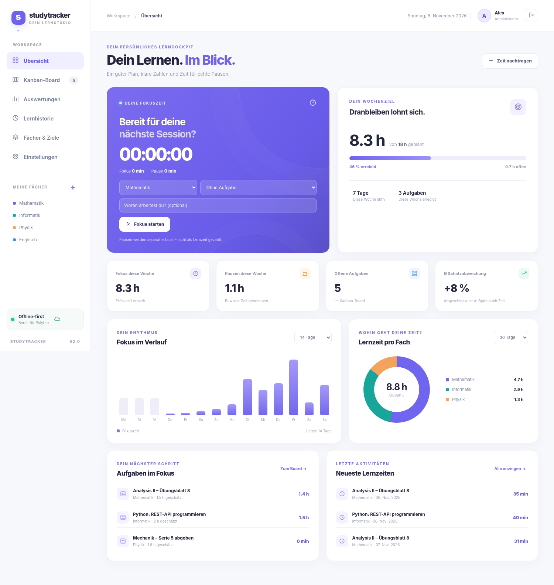

# StudyTracker 2.0 — Study Time, Kanban, Breaks & Agent Imports

**A free, locally hosted study-tracking app for Ubuntu/Linux**, with multiple user accounts and full control over your data. Works with your existing **Polybox synchronization folder**—no hosting, paid server, or third-party Python packages required.



## Features

| Area | Features |
|---|---|
| **Kanban board** | To Do → In Progress → Done, drag and drop, task title, subject, description, due date, priority, and tags |
| **Time estimates** | Set an estimate in minutes for each task; record any number of study sessions against it |
| **Estimated vs. actual time** | Per-task differences in minutes and percentages, plus an aggregated trend across completed, time-tracked tasks |
| **Timer and breaks** | Start focus time, start/end a break, pause/resume tracking, and save sessions; breaks are recorded separately with timestamps |
| **Multiple users** | The first account is an administrator; create additional accounts with passwords and separate profiles, timers, and tasks |
| **Study history** | Add, edit, and delete sessions; assign each session to a subject and optionally a task |
| **Analytics** | 7-, 14-, and 30-day views; 13-week and 12-month trends; all-time totals, subject breakdowns, weekly goals, and break statistics |
| **Exports** | Full JSON profile backup, study-session CSV, and tasks CSV (UTF-8 with BOM, semicolon-delimited) |
| **Agent task imports** | Import tasks generated from emails as JSON through a file upload or an automatically processed Polybox inbox folder; duplicate detection included |

### Screenshots (using sample data)

| Screen | Screenshot |
|---|---|
| Dashboard | [Dashboard.png](docs/screenshots/Dashboard.png) |
| Kanban board | [Kanban.png](docs/screenshots/Kanban.png) |
| Create task | [Aufgabe-anlegen.png](docs/screenshots/Aufgabe-anlegen.png) |
| Estimated vs. actual analytics | [Statistik.png](docs/screenshots/Statistik.png) |
| Study history | [Lernhistorie.png](docs/screenshots/Lernhistorie.png) |
| Settings and user management | [Einstellungen.png](docs/screenshots/Einstellungen.png) |
| Running timer | [Timer.png](docs/screenshots/Timer.png) |
| Break in progress | [Pause-laeuft.png](docs/screenshots/Pause-laeuft.png) |
| Break timestamps | [Pausen-Details.png](docs/screenshots/Pausen-Details.png) |
| Narrow/mobile browser layout | [Mobil.png](docs/screenshots/Mobil.png) |
| First-run account creation | [Anmeldung.png](docs/screenshots/Anmeldung.png) |

## Installation on Ubuntu

**Requirements:** Python 3.10 or newer (`python3 --version`) and a modern web browser. A working Polybox sync client is needed only if you want Polybox synchronization. **No `pip install` is required.**

1. Download and extract the project ZIP. If you want Polybox synchronization, move the complete project folder into your **locally synchronized Polybox directory**.
2. Open a terminal in the project directory and run:

   ```bash
   chmod +x start.sh
   ./start.sh
   ```

3. The app should open automatically at **http://127.0.0.1:8765**. You can also open that address manually.
4. On first launch, create an administrator account with a **password of at least 10 characters**.
5. Create subjects or rename the sample subjects, add Kanban tasks, and use a task card's **Start** button to begin tracking.
6. To add more users, go to **Settings → User Accounts** in the app.

To change the port if `8765` is already in use:

```bash
./start.sh --port 8766
```

To start without opening the browser (for example, to process an import inbox):

```bash
./start.sh --no-browser
```

> StudyTracker binds to **`127.0.0.1` only**. It is not accessible from the public internet or automatically from another computer. Multiple accounts allow different people to use one running local instance. Polybox provides **file synchronization, not web hosting or a shared database server**.

### Polybox synchronization and data storage

The simplest setup is to keep the entire project in your local Polybox folder. User data is stored under `data/`:

```text
StudyTracker-Polybox-v2/
├── server.py                   # Local web server and API
├── static/                     # Web interface
├── data/                       # Personal data; created on first use
│   ├── accounts.json           # Usernames and salted password hashes
│   ├── profiles/<id>.json      # Subjects, tasks, sessions, breaks per user
│   ├── inbox/<username>/       # Incoming automated task imports
│   │   ├── processed/          # Successfully processed files
│   │   └── rejected/           # Invalid files and error explanations
│   └── legacy-state-v1.json    # Only after migrating from version 1
├── AGENTS.md                   # Instructions for AI agents
└── tests/                      # Automated tests
```

**Do not use two computers against the same Polybox-synchronized dataset at the same time.** Polybox synchronizes files but cannot safely merge conflicting changes to a JSON database. Multiple users working within **one running StudyTracker instance** are supported through separate profiles and synchronized writes. When switching computers, stop the app, allow Polybox to finish syncing, and only then start it on the other computer.

Personal data in `profiles/*.json` is **not encrypted** on disk or in Polybox. Passwords are stored only as salted PBKDF2-HMAC-SHA256 hashes. Keep the folder private and do not share its contents publicly. JSON profile backups do **not** include account passwords.

#### Change the data directory

To keep application code outside Polybox while synchronizing only the data, set `STUDYTRACKER_DATA_DIR` before launching:

```bash
export STUDYTRACKER_DATA_DIR="$HOME/Nextcloud/StudyTrackerData"
./start.sh
```

Use the correct path to **your** local Polybox/Nextcloud folder. The separate data directory should not be inside a public Git repository.

### Migrating from StudyTracker 1.0

If your old installation contains `data/state.json`, copy it to `data/state.json` in the new project **before creating the first user**. On first-account creation, StudyTracker imports your subjects, tags, sessions, and weekly goal. It also retains the original as `data/legacy-state-v1.json`.

A currently running timer is **not** migrated. Create a manual backup of version 1 before migrating.

## Kanban and estimated-vs.-actual analytics

1. Create a task—for example, **“Linear Algebra: Problem Set 4”**—with an estimate of **60 minutes**.
2. Start the timer from that task's Kanban card. All subsequent sessions assigned to the task contribute to its actual time.
3. Use **Start Break / End Break** for a real study break. **Pause tracking** is a separate action and does not record break time.
4. End and save your focus session. Repeat as needed.
5. Move the task to **Done**, either by dragging the card or editing its status.
6. Open **Analytics** to review the estimate, actual time, differences, and aggregate totals.

**Example:** A 60-minute estimate, two focus sessions of 20 and 25 minutes, and a 10-minute break result in **45 minutes of actual study**, a **15-minute saving** (**25% under the estimate**). The break is excluded from the task's actual study time but included in break statistics.

**Aggregation rule:** Only **completed tasks with measured time** contribute to estimated-vs.-actual summary metrics. Open tasks and completed tasks without recorded time are excluded; otherwise, tasks with zero measured time would incorrectly appear exceptionally fast. All recorded sessions still remain in the history.

## Automated task imports (ChatGPT and other agents)

The full agent instructions are in [`AGENTS.md`](AGENTS.md). A ready-to-use prompt is in [`prompts/email-to-tasks.md`](prompts/email-to-tasks.md), and a sample payload is in [`examples/email-task-import.json`](examples/email-task-import.json).

1. An agent extracts study tasks from an email, PDF, or another source and produces JSON using the **`studytracker.tasks.v1`** format.
2. Import the file in **Settings → Import → Import Tasks JSON**, or place it in **`data/inbox/<username>/`**.
3. While StudyTracker is running, it automatically reads complete JSON files from the inbox, creates any missing subjects/tags, adds new tasks in the **To Do** column, and skips duplicates.

Example JSON payload:

```json
{
  "format": "studytracker.tasks.v1",
  "batch_id": "email-2026-11-08-problem-set-5",
  "tasks": [
    {
      "external_id": "email-2026-11-08-problem-set-5:1",
      "subject": "Mathematics",
      "title": "Complete problem set 5, exercises 1–4",
      "description": "Solve the four assigned exercises.",
      "planned_minutes": 90,
      "priority": "normal",
      "due_date": "2026-11-18",
      "tags": ["Problem Set", "From Email"]
    }
  ]
}
```

For a convenient command-line import, run:

```bash
python3 scripts/add_tasks.py --user alex --file ~/Downloads/tasks.json
```

The importer recognizes already-processed batches and stable task `external_id` values to avoid duplicates. Valid and processed files are moved to `processed/`; invalid files go to `rejected/` with an error message. See [`docs/IMPORT.md`](docs/IMPORT.md) and [`schemas/tasks-import.schema.json`](schemas/tasks-import.schema.json) for the full contract.

**Not included:** StudyTracker does **not** directly access Gmail, Outlook, or other email accounts. Email retrieval and creation of the JSON file require a separately configured agent or workflow. Once a valid file has been placed in the inbox, import is automatic while the app is running.

## Backups and exports

From **Settings**, you can:

- **Download a full JSON profile backup:** Includes the signed-in user's subjects, tags, tasks, sessions, breaks, goals, and import history. Does not contain passwords, login sessions, or an active timer.
- **Export study sessions as CSV:** Includes session, subject, task, UTC start/end times, focus minutes, break minutes, individual break intervals with timestamps, tags, and notes.
- **Export tasks as CSV:** Includes subject, status, priority, estimate, actual time, and absolute/percentage deviation.
- **Restore a JSON backup:** Replaces only the currently signed-in user's profile, after explicit confirmation.

Additionally, before the first profile change each day, StudyTracker creates a local backup under:

```text
~/.local/share/studytracker/backups/
```

It retains the latest **30 daily backup files per user profile**. These backups intentionally live outside the Polybox project folder, offering some protection against synchronization issues. Back up `data/accounts.json` separately if you need to restore user accounts on another computer.

## Development

Run the tests and basic checks:

```bash
python3 -m unittest discover -s tests -v
python3 -m py_compile server.py
node --check static/app.js    # Optional; requires Node.js
```

Repository structure:

```text
.
├── .github/workflows/tests.yml
├── .gitignore
├── AGENTS.md
├── LICENSE
├── README.md
├── server.py
├── start.sh
├── static/
│   ├── index.html
│   ├── app.css
│   └── app.js
├── schemas/tasks-import.schema.json
├── docs/
│   ├── IMPORT.md
│   ├── API.md
│   └── screenshots/
├── prompts/email-to-tasks.md
├── examples/email-task-import.json
├── scripts/add_tasks.py
└── tests/
    ├── test_server.py
    └── test_http.py
```

Additional commands: `python3 server.py --help`. The HTTP API is documented in [`docs/API.md`](docs/API.md). The backend uses only the **Python standard library**; no external analytics tracking, CDN, or API key is required.

### Publish the code on GitHub

The project is **GitHub-ready**, but it is not automatically published to a remote repository.

```bash
git init
git add .
git commit -m "Initial StudyTracker v2"
git branch -M main
# Create an empty GitHub repository, then use its actual remote URL:
git remote add origin <YOUR-GITHUB-REPOSITORY-URL>
git push -u origin main
```

The included `.gitignore` contains `/data/`, so personal data under the repository's root `data/` directory is ignored **unless it was already tracked by Git**. Check the repository before pushing:

```bash
git check-ignore -v data/accounts.json
git ls-files data/
git status --short
```

`git ls-files data/` should output nothing. Remember that manually exported files outside `data/` may not be ignored. Do not commit personal data or secrets to a public repository.

## Known limitations

- No public web hosting, shared real-time database, or safe concurrent editing of the same Polybox folder from separate computers.
- No automatic retrieval of email messages; that requires a separately configured agent or integration.
- Active timers use saved timestamps. They can continue to accumulate elapsed time after you close the browser, as long as the local server and profile persist. After a computer restart, elapsed time since the last focus/break start may be shown; review and correct or discard an inaccurate session.
- User accounts do not currently offer self-service password resets. Recovery requires an administrative process using an account-data backup.

## License

MIT. See [LICENSE](LICENSE).
